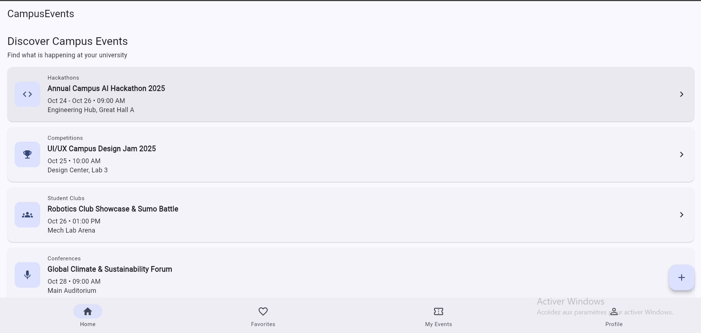
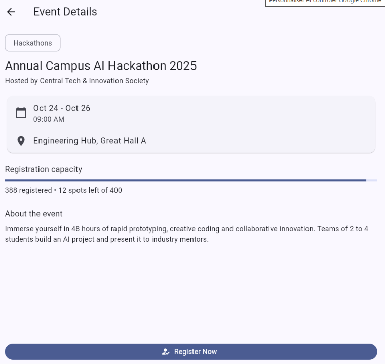
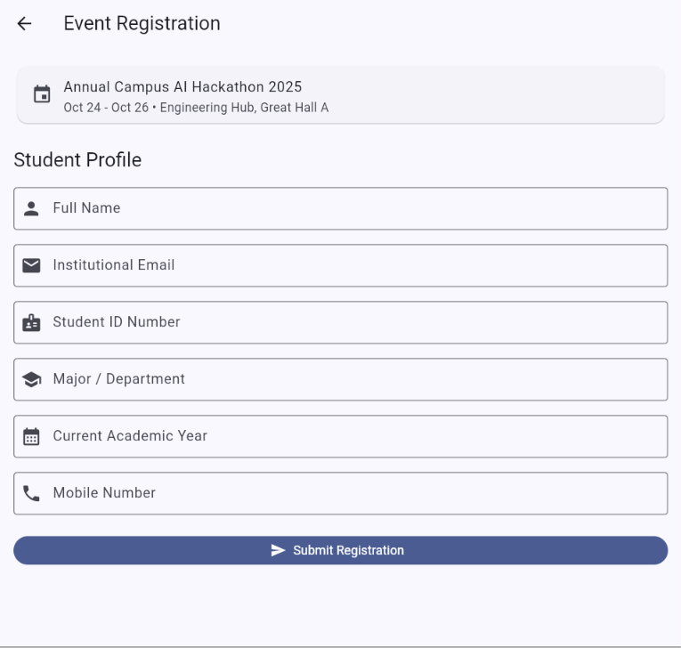
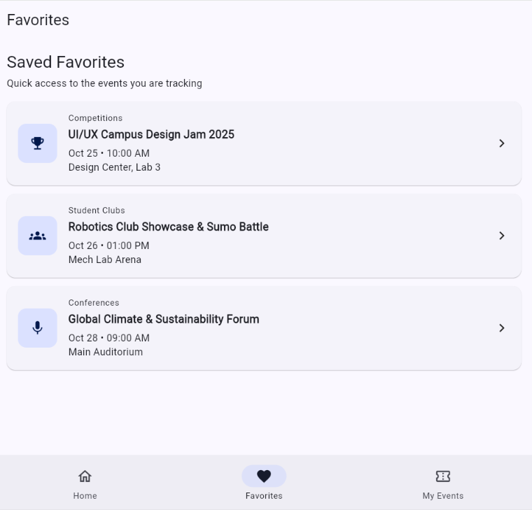
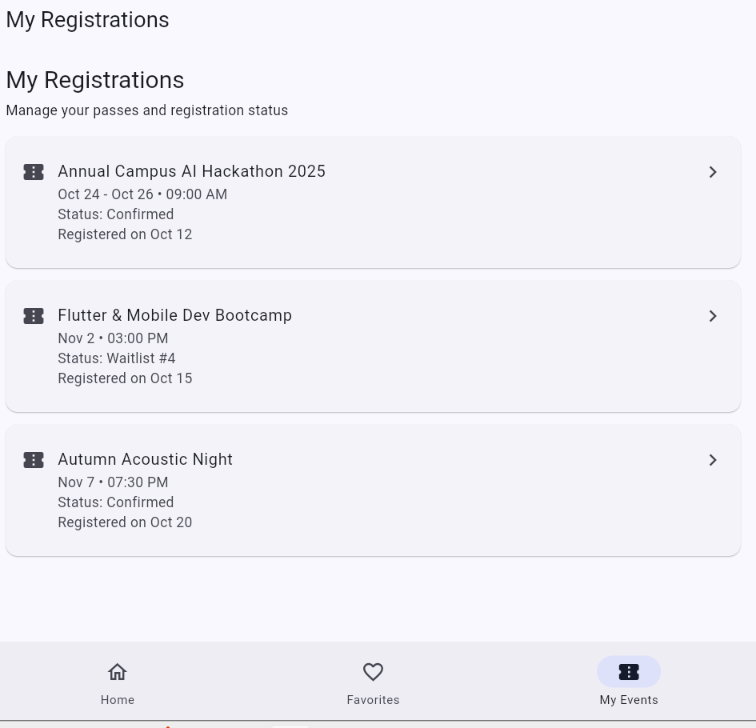
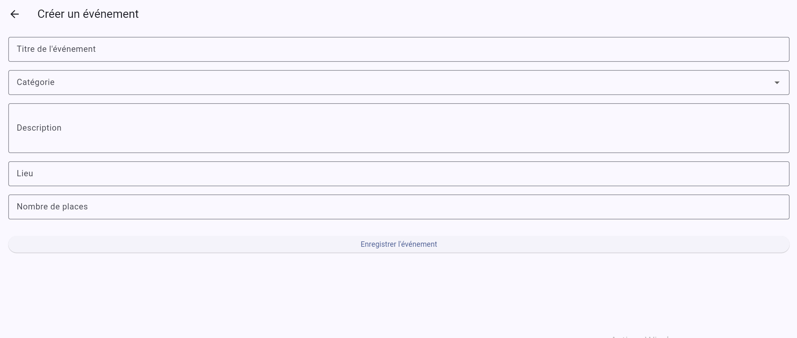
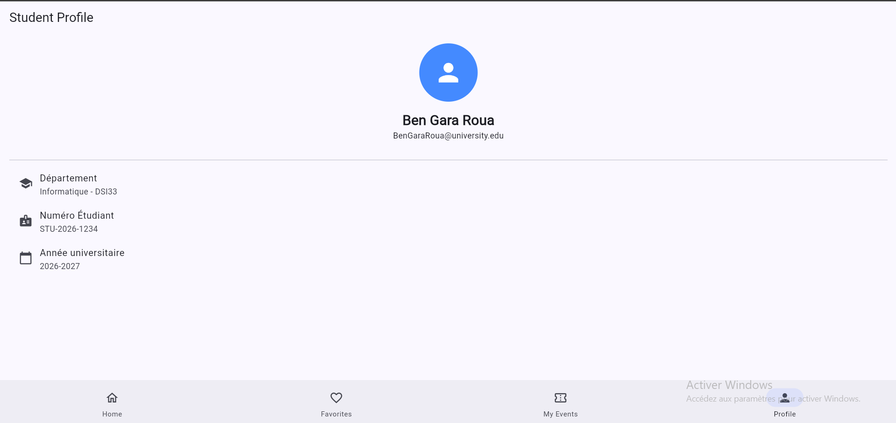
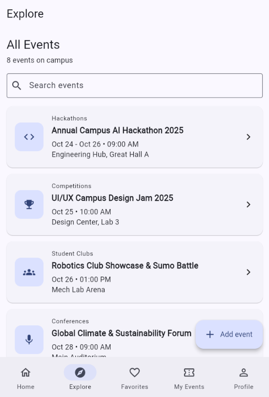
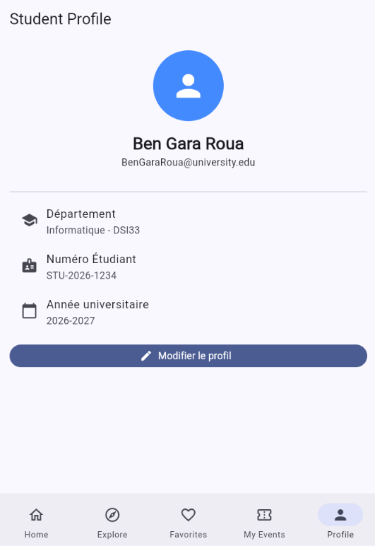
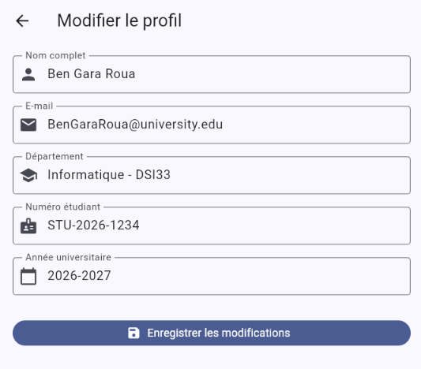

# campusevents

A new Flutter project.

## Getting Started

This project is a starting point for a Flutter application.

A few resources to get you started if this is your first Flutter project:

- [Lab: Write your first Flutter app](https://docs.flutter.dev/get-started/codelab)
- [Cookbook: Useful Flutter samples](https://docs.flutter.dev/cookbook)

For help getting started with Flutter development, view the
[online documentation](https://docs.flutter.dev/), which offers tutorials,
samples, guidance on mobile development, and a full API reference.

<h2>Home_screen</h2>

<h2>Details_Event_screen</h2>

<h2>Formulaire_enregistrement_screen</h2>

<h2>my_event_registrations_screen</h2>

<h2>Favorites_screen</h2>

## Jalon J1 : le squelette

### Captures d'écran

| Home (avec bouton +) | Event Details | Event Registration (Étudiant) |
| --- | --- | --- |
|  |  |  |

| Favorites | My Registrations | Add Event (Organisateur) |
| --- | --- | --- |
|  |  |  |

| Profile |
| --- |
|  |

| Explore (avec bouton ajouter) | Profil modifier | Update Form (profile) |
| --- | --- | --- |
|  |  |  |

### Schéma de navigation

- Home → Event Details (clic sur une carte) → Event Registration (bouton "Register Now")
- Explore → Event Details (clic sur une carte) → Event Registration
- Explore → Add Event / Formulaire (bouton « Add event »)
- Favorites → Event Details (clic sur une carte) → Event Registration
- My Registrations → Event Details (clic sur une carte) → Event Registration
- Home → Add Event / Formulaire (clic sur le bouton flottant "+" en bas à droite)
- Profile → Edit Profile (bouton « Modifier le profil »)

**Navigation principale (Barre du bas) :**
- Home ↔ Explore ↔ Favorites ↔ My Registrations ↔ Profile

### Structure du code

- **`lib/models/`** : classes `Event` et `Registration`.
- **`lib/data/`** : `donnees_fictives.dart` (8 événements, favoris, inscriptions).
- **`lib/screens/`** : 
  - `main_screen.dart` (gestion de la barre de navigation du bas)
  - `home_screen.dart` (écran d'accueil avec le bouton d'ajout)
  - `event_details_screen.dart`
  - `event_registration_screen.dart` (formulaire d'inscription étudiant)
  - `favorites_screen.dart`
  - `my_registrations_screen.dart`
  - `formulaire_screen.dart` (formulaire de création d'événement)
  - `profile_screen.dart` (écran de profil)
    - `explore_screen.dart` (tous les événements + bouton d'ajout)
  - `edit_profile_screen.dart` (formulaire de modification du profil)
- **`lib/widgets/`** : `event_card.dart` (le composant de la carte d'un événement).

